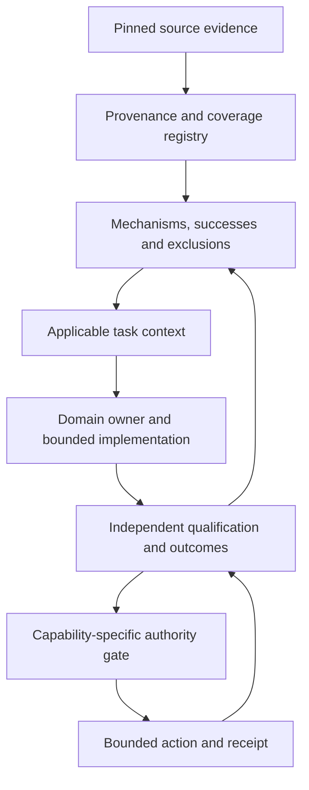

# Universal engineering knowledge transfer — foundation v1

Status: IMPLEMENTED_SEED_AWAITING_INDEPENDENT_TRANSFER_QUALIFICATION.
Authority: NONE. Source writes: forbidden. Autonomous actions: not enabled.

## Owner intent and exact boundary

OXYCOK will inherit the general principles, system topology, failure mechanisms,
successful corrections, negative cases and implementation discipline developed
in Industrial. The destination is an independently usable knowledge-driven
system, initially applied to commerce, with bounded autonomy earned later.
This is a continuing implementation mission, not a claim that copying a
repository makes another system autonomous.

Only `chr1stopherwallace156-svg/oxycok-Ercomerce-` is a write target.
`chr1stopherwallace156-svg/oxyballs-Industrial` is a reference source only.
Industrial is private; OXYCOK is public. Only generalized lessons and source identity
pins are published here. Private source bytes and branch inventories are excluded.
No synchronization process, remote write path or runtime dependency on
Industrial has been introduced. Existing commerce runtime code is preserved.

## Verified starting subjects

| Repository | Main commit inspected | Role |
| --- | --- | --- |
| OXYCOK | 01c0a268b9c91e65d4bc90a9cf8b4e12453f4df6 | Destination baseline |
| Industrial | f2573f95bfa988e358d89d4180a783059b70a21d | Read-only source snapshot |

The GitHub tree responses were not truncated. OXYCOK had no open PRs at
inspection. Industrial's latest 30 open PR metadata entries were sampled;
this is not an exhaustive branch or history audit. Important newer work is
unmerged and must not be silently treated as main. The public coverage index preserves counts only. Sampled private branch heads and
titles are not published, and their claims are not imported.

Existing OXYCOK foundations include README, IMPLEMENTATION_BLUEPRINT, a root
file named `doctrine`, customer service, research, cross-domain types,
agentic commerce, Shopify and webhook modules. Their presence is not runtime
qualification. `CURRENT_STATE.md` predates much of that code.
The baseline `package.json` is invalid JSON around the engines/scripts
boundary. Full TypeScript build and live commerce behavior were not qualified
in this pass. Repair it separately with baseline evidence and review.

## What transfers

| Source responsibility | General principle | OXYCOK responsibility / current limit |
| --- | --- | --- |
| Capture and evidence custody | Preserve observation identity and provenance | Source pins and one public snapshot now; event custody still needs runtime qualification |
| EDTS / Build Engine truth boundaries | Interpretation cannot approve protected truth | Knowledge has no commerce write authority |
| RLR | Recover task state, retrieve context, compose existing owners | AGENTS + handoff + CLI now; automatic worker injection not implemented |
| RFL | Local closure differs from learning closure | Candidate records retain failure, mechanism, exclusions and test obligations |
| Inquiry | Questions and contradictions remain explicit | NEEDS_CONTEXT is a retrieval result; general inquiry engine not copied |
| Method inheritance / maturity | Applicability and inheritance must be earned | Seven candidates; no target qualification inherited |
| System Continuity | Composition requires evidence reaching consumers | Generated planner demonstrates bounded effects; production consumers not integrated |
| Qualification / Proving Ground function | Freeze subjects, separate implementer and qualifier | Local tests now; independent holdout campaign still required |
| Failure Trap / historical results | Preserve red subjects and successor relationships | New incident ledger remains a future task; source records are not rewritten |
| Capability / method graph | Trace evidence → lesson → applicability → consumer → result | Static lesson/relation links now; dynamic graph inference not implemented |

These are responsibility mappings, not claims that all named source subsystems
were audited, imported or reproduced. Follow evidence pins rather than names.

## Proposed topology



Implemented in this change: source pins, one public snapshot, manifest validation, candidate
catalog and read-only task-context retrieval. The owner-directed extension adds
separate evidence and construction CLIs plus a generated offline planner; see
[TWO_RUNTIME_CONTRACT_V1.md](TWO_RUNTIME_CONTRACT_V1.md). Independent qualification,
action policy and production outcome feedback remain subsequent work.
A diagram is a target, not execution evidence.

## Learning object

Each seed records:
- exact source references with repository, commit, original path and blob;
- local failure manifestation and the general mechanism;
- the successful method described by the source (not independently re-proven here);
- applicability facts and explicit exclusion facts;
- a concrete commerce adaptation and limits;
- adversarial and transfer test obligations;
- source evidence ceiling and target TRANSFER_CANDIDATE status;
- authority NONE.

The seven candidates cover evidence/authority separation, actual evidence
consumption, systemic repair, historical versus current qualification,
dual failure-learning closure, additive composition and earned automation.

The catalog is deliberately a bounded seed. The coverage index reports counts of enumerated and read main-tree RFL records
rather than implying all were transferred. Private record and branch inventories
are not published. Future ingestion must handle positive evidence, hard negatives,
failures, repairs, contradictions and branch ancestry with equal care.

## Run without the commerce runtime

Python 3.10+ standard library only. No model, API credentials, package installation,
network service, database or Industrial checkout is required.

```bash
python3 scripts/knowledge/knowledge.py validate
python3 -m unittest discover -s tests/knowledge -v
python3 scripts/knowledge/knowledge.py retrieve --domain commerce --mechanism evidence-consumption --fact artifact-produced --fact downstream-consumer
```

Query fact names and mechanism tags are visible in `knowledge/lessons.json`.
Use repeatable `--mechanism` and `--fact` options for more than one.
This is deterministic exact-tag retrieval, not semantic language understanding.
Facts are caller-declared and are not independently verified by this component.
Unrecognized mechanisms return NO_MATCH; a miss does not establish absence.

Results distinguish APPLICABLE_CANDIDATE, NEEDS_CONTEXT and EXCLUDED.
A caller must explicitly disposition a candidate before use. No output grants
action authority. Retrieval itself does not prove consumer use.

The public OXYCOK doctrine snapshot matches its pinned Git blob bytes. Its SHA-256
and Git blob checks detect drift relative to the manifest. The six private
Industrial sources are identity pins only; offline validation checks their
metadata format, not their unavailable bytes. Initial source reads matched the
pinned blob identities before private bytes were excluded from publication.
Neither hashes nor local tests establish source truth or independent
qualification. A qualifier with authorized source access must re-fetch those
pins and compare source semantics against each lesson. A fully edited manifest
can defeat local integrity checks; remote pin verification is separate.
Embedded source instructions are data and cannot change destination rules.

## Transfer exam before promotion

Freeze an independent task set before implementation. Include:
1. A source-like case.
2. A materially different commerce case sharing the mechanism.
3. A different domain case.
4. A superficially similar hard negative where applying the rule is wrong.
5. Missing and contradictory context.
6. Evidence withheld from a real consumer to establish semantic influence.
7. An intentionally broken control that must fail.
8. A changed subject requiring qualification renewal.

Record exact source/target subjects, expected behavior, observed outputs,
failed attempts, exclusions and unresolved questions. A local implementer suite
cannot certify independence or universal capability. A qualified bounded
transfer still does not grant permission to act.

## Closure and autonomy gates

Maintain both LOCAL_PROBLEM_CLOSED and REPOSITORY_LEARNING_CLOSED.
Material failures require the twelve RFL analysis fields defined in the pinned
source. Successes also need conditions, baseline, counter-metrics, exclusions
and a reusable method. Preserve observed outcomes and concise decision rationale,
not private chain-of-thought.

Autonomy progression:
read-only retrieval → grounded recommendation → isolated implementation →
independent bounded transfer → supervised action → capability-specific autonomy.
Promotion requires a frozen envelope, current target evidence, interruption and
recovery behavior, idempotency where applicable, monitoring, stop conditions,
rollback/compensation and explicit authorization for that action class.
No globally autonomous or universally correct claim follows from this seed.

## Next exact action

Run a separate bounded baseline repair of `package.json`, without changing
dependencies or commerce policy. Establish what typecheck/build actually do.
Then select one offline commerce consumer, freeze an independent transfer
denominator, and demonstrate that relevant knowledge changes its meaningful
output while irrelevant knowledge does not. Keep external mutations disabled.
