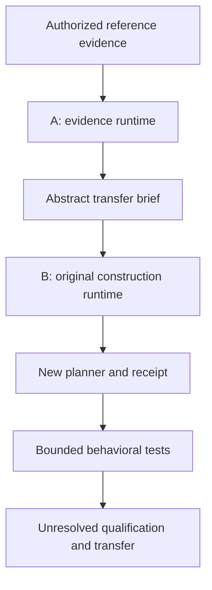

# Evidence and original construction runtimes v1

Status: IMPLEMENTED_BOUNDED_CANDIDATE. Independent qualification: NOT_ESTABLISHED.
Source repository writes: forbidden. Action authority: NONE.

## Owner directive, 2026-10-18

The owner authorized publication of the prepared generalized lesson package and
source identity references to OXYCOK's public repository. This does not authorize
changes to Industrial, publication of raw private source documents, reuse of
unrelated third-party code, merging, or autonomous commerce actions.

The owner additionally requested one runtime to retrieve and understand reference
knowledge, and another to construct an implementation of their own. The term
`REA` was used by the owner but its expansion has not been established. The
source search returned substring matches, not an authoritative REA definition.
Do not invent a subsystem identity or claim all REA functionality is implemented.

## Separation

| Responsibility | Runtime A: evidence | Runtime B: construction |
| --- | --- | --- |
| Input today | Curated, pinned seven-lesson catalog; scoped relation registry; caller facts | Strict abstract transfer brief |
| Reads source implementation code | No automatic source-code ingestion implemented | No |
| Output | Abstract principles, failure/success mechanisms, applicability, exclusions, test obligations and pins | New offline planner project plus construction receipt |
| Dependencies | Existing offline knowledge loader and local registries | Its own contract validator and project-authored template |
| External writes | None | None; new local directory only |
| Qualification claim | Candidate evidence synthesis | Candidate construction; NOT_ESTABLISHED |
| Future growth | Authorized source adapters, corpus coverage, contradiction analysis, evidence evaluation | Original implementation workers and isolated execution |
| Present limitation | Deterministic catalog assembly, not general semantic understanding | One planner template, not a general application generator |

Two separate processes are tested. The constructor runs after being copied into
an otherwise isolated temporary directory with only its validator and brief.
This demonstrates a data boundary; it is not an operating-system sandbox,
legal clean-room certification, or proof of independent authorship.



## What the brief carries

The validator owns an exact field contract. Unexpected fields, duplicate JSON
keys, invalid hashes, unsupported promotion or authority, unscoped relations and
missing requirements block construction. The brief carries:
- caller domain and declared facts, explicitly unverified;
- principles plus failure and successful mechanism descriptions;
- positive conditions, exclusion boundaries and target test obligations;
- typed, scoped relation candidates;
- evidence identity pins, not original reference implementation bytes;
- code reuse PROHIBITED and legal clearance NOT_ESTABLISHED;
- a content hash for accidental drift detection.

Text remains JSON data. It is never evaluated or inserted into Python executable
statements. This prevents this constructor from executing embedded instructions;
it cannot prove all prose is original, properly licensed, correct or complete.
A recomputed digest is not a signature or evidence of trustworthy origin.

## Relations: do not collapse meanings

The owner's `X != Y` / `Y = X` examples describe distinctions this system must
preserve. Equation-like labels require explicit semantic scope and evidence.

| Relation | Meaning | Does not establish |
| --- | --- | --- |
| NOT_EQUIVALENT | X and Y are different obligations or claims | X is false, Y is true, or neither can occur together |
| DOES_NOT_IMPLY | Evidence for X alone is insufficient for Y | X and Y are incompatible |
| IMPLIES_UNDER_CONDITIONS | A directional implication is proposed within named conditions | The reverse implication |
| EQUIVALENT_UNDER_CONDITIONS | Both directions are proposed within named conditions | Global equality outside that envelope |
| ANALOGOUS_UNDER_CONDITIONS | A shared mechanism is proposed across contexts | Identical behavior, ownership or authority |
| CONTRADICTS | Claims are proposed to be incompatible within a shared scope | Which claim wins or which source is authoritative |

All seven seed relations remain CANDIDATE. The runtime neither automatically
derives converse implications nor proves arbitrary equalities, causation,
contradictions or mathematical theorems. Contradictory candidates require a
future explicit adjudication process. Similar phrasing is not mechanism identity.

Examples retained in the seed:
- content identity verified does not imply action authorized;
- artifact produced does not imply evidence consumed;
- local repair complete is not equivalent to repository learning complete;
- historical qualification does not imply current changed-subject qualification;
- a shared mechanism can be analogous in a different domain under tested conditions;
- repeated success does not imply autonomous permission.

## Positive and negative knowledge

A useful method must preserve the failed assumption, observed failure, candidate
general mechanism, successful correction, applicability, hard negatives,
unknowns, source versions and future tests. Repeating the originating example
is not transfer qualification. Absence of a failure is not proof of coverage.
A positive local result does not erase earlier red evidence.

Current generated planner behavior:
- exclusion fact present → EXCLUDED;
- required facts missing → NEEDS_CONTEXT;
- required facts present without exclusions → REVIEW_REQUIRED + test obligations.
Every case retains authority NONE, action_authorized false and qualification
NOT_ESTABLISHED. Facts and relations remain inputs, not instructions.

## Run the two runtimes

Python 3.10+ standard library only. From the repository root, create demo output
outside existing projects:

```bash
demo_dir="$(mktemp -d)"
python3 scripts/transfer/evidence_runtime.py --domain commerce --mechanism evidence-consumption > "$demo_dir/brief.json"
python3 scripts/transfer/construction_runtime.py --brief "$demo_dir/brief.json" --output "$demo_dir/my-planner"
echo '["artifact-produced","downstream-consumer"]' | python3 "$demo_dir/my-planner/runtime.py"
```

A creates no files itself. Shell redirection in the example saves its output.
B creates runtime.py, contract.json, README.md and construction_receipt.json in a
new directory. It refuses existing destinations and paths resolved inside a
directory named oxyballs-Industrial. That path check is a convenience guard,
not a general access-control system. B does not contact GitHub or any service.

## Rights and originality

The owner wants to learn general ideas and create original implementations,
not conceal copying through renamed variables or automatic translation.
The U.S. Copyright Office distinguishes protected program expression from
functional aspects such as algorithms and logic:
https://www.copyright.gov/register/tx-programs.html
https://www.copyright.gov/circs/circ61.pdf

This design provides provenance, an abstract interface and a restriction against
code reuse in this constructor. It does not decide copyright, license, patent,
contract or confidentiality questions. Publicly accessible code is not assumed
licensed for reuse. Any future third-party adapter must record source owner,
version, access basis, applicable license/terms, allowed use, attribution duties
and unresolved restrictions before code reuse or redistribution. Unresolved
rights remain unresolved; a rewrite does not generate legal clearance.

All executable additions here were authored for this project. No Industrial
executable code was copied into the construction template. Source lesson
summaries remain explicitly derived knowledge, with the owner's publication
authorization; authorship and legal clearance are not inferred from that alone.

## Tests, remaining work and autonomy

Commands:
```bash
python3 -m unittest discover -s tests/knowledge -v
python3 -m unittest discover -s tests/transfer -v
```

The 19 knowledge tests and 15 runtime tests are implementer evidence. The
separate-process test demonstrates an actual generated consumer responding
differently to positive, missing and excluded conditions. It does not test
independently chosen unfamiliar missions, prove universal understanding or
qualify production commerce.

Next: define REA with the owner; freeze an independent transfer task set; ingest
remaining authorized source knowledge through explicit dispositions; establish
the existing commerce package/build baseline; then develop original domain
workers behind this boundary. Automation remains capability-specific and
requires separate execution, recovery, monitoring, outcome and authority gates.
