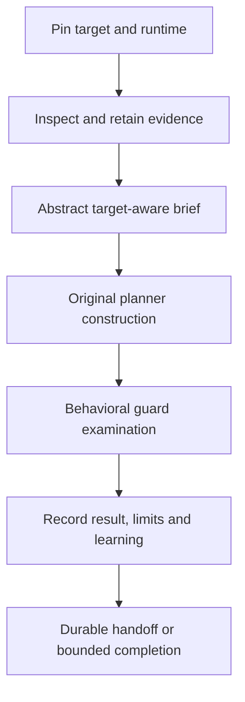

# OXYCOK REA mission runtime v1

Status: IMPLEMENTED_BOUNDED_CANDIDATE; external REA provider ENVIRONMENT_BLOCKED.
Qualification: implementer tests only. Authority: NONE.

## One connected runtime, separate responsibilities

The owner requested a continuous engineering mission rather than mandatory
24/7 execution. The coordinator in scripts/mission/runtime.py composes the prior
evidence and construction stages without merging their responsibilities.



Provider operations: OXYCOK static Python AST inspection, or optional REA 6.7.0
static JavaScript analysis. No target Python import, JavaScript execution,
binary launch, arbitrary shell command, Git mutation or production commerce
action is offered by this coordinator.

## State and topology

Stages: NEW → INSPECTED → ABSTRACTED → CONSTRUCTED → TESTED → RECORDED → COMPLETE.
A material error produces terminal BLOCKED with a preserved FAILURE_PRESERVED
event. It does not become PASS on a retry. A new attempt receives a different
mission identity and keeps the old attempt intact.

SQLite stores mission identity, requests, checkpoints, content-addressed JSON
artifacts, events and provenance edges. Events are append-only through the API;
this is not a tamper-proof database against a privileged editor. Artifact hashes
detect accidental content drift relative to retained keys. They are not
signatures, trusted attestations or an alternative to external subject custody.

One BEGIN IMMEDIATE transaction serializes each transition. Constructor output
is outside the database transaction: a fully valid orphan is verified and reused
after interruption; partial or altered output blocks and is preserved.
There is no silent cleanup or destructive overwrite.

The state root must be separate from the inspected target. The CLI rejects
overlap before creating state. Target inventory rejects symbolic/special entries
and bounds retained worktree files to 512 and 4 MB, explicitly excluding .git.
All stages check target inventory and current implementation identity. Changes
invalidate continuation rather than borrowing the previous subject's result.
Completed missions remain historical; starting against a changed subject creates
a new identity. Local source paths are retained in local requests and diagnostics.

Graph edges connect mission → target → observation → abstract brief → candidate →
test report → learning. Python syntax call expressions have explicit
SYNTAX_CALL_TARGET edges; they do not claim dynamic call resolution.

## Target-aware abstract boundary

Brief version 1 remains supported. Version 2 adds only a strict target-evidence
object: target/observation hashes, provider, coverage status and limitations.
No target implementation source text crosses into the constructor. The planner
holds both the method conditions and target evidence metadata.

Unknown provider coverage changes an otherwise applicable output to
EVIDENCE_INCOMPLETE. Missing facts remain NEEDS_CONTEXT, hard negatives EXCLUDED,
and bounded positive conditions REVIEW_REQUIRED. No case grants action authority.
Static Python inspection reports BOUNDED_STATIC and its dynamic-behavior limits.
The REA adapter conservatively reports UNKNOWN until its coverage mapping has
been separately established.

## Run, stop and resume

Python 3.10+ on POSIX for the bounded external-process adapter. No credentials or
Industrial checkout are required. Existing commerce package.json is untouched.

```bash
python3 scripts/mission/runtime.py --state-root /tmp/oxycok-mission start --target /absolute/path/to/owned-python-project --provider python --domain commerce --mechanism evidence-consumption --fact artifact-produced --fact downstream-consumer
python3 scripts/mission/runtime.py --state-root /tmp/oxycok-mission step --mission-id RETURNED_ID
python3 scripts/mission/runtime.py --state-root /tmp/oxycok-mission run --mission-id RETURNED_ID --max-steps 6
python3 scripts/mission/runtime.py --state-root /tmp/oxycok-mission status --mission-id RETURNED_ID
python3 scripts/mission/runtime.py --state-root /tmp/oxycok-mission events --mission-id RETURNED_ID
python3 scripts/mission/runtime.py --state-root /tmp/oxycok-mission graph --mission-id RETURNED_ID
```

Stopping the CLI between calls does not lose the checkpoint. Run again to resume.
Each invocation has an explicit transition budget of 1..20; there is no service
daemon or 24/7 assumption.

For owned JavaScript inputs, use --provider rea and --rea-executable with an
absolute installed 6.7.0 rea command. Version checking alone is not package
integrity verification; the caller must supply a trusted installation. The package is separately obtained; the
repo does not auto-install it or register it with an agent.
This environment's actual REA probe failed its own process-ownership prerequisite.
Run on a supported host and preserve the resulting evidence; do not bypass that
prerequisite or substitute a simulated provider as real proof.

## Qualification and metrology

QUALIFICATION_DENOMINATOR_V1.json was committed before implementation at
3bca7e199b1254a956f733aa349b3c6c63f1adb5. It is implementer-preregistered,
not independently authored. It is unchanged by the implementation successor.

Local tests exercise fresh-process resume, duplicate admission, subject drift,
artifact corruption, orphan/partial construction recovery, state isolation,
static nonexecution, behavioral broken controls, unknown coverage, failure
retention, output/timeout bounds and concurrent transitions.
The generated consumer's behavioral report measures the guard behavior only.
It does not prove source-feature equivalence or full application generation.

Metrology records observed file/byte/module/call-site counts and provider reply
size. Source receipt test counts remain historical counts. No speed, coverage
universality, intelligence or commercial-readiness claim follows from them.

COMPLETE means this bounded workflow finished. It does not mean independently
qualified, universally correct, legally cleared or authorized to act. The real
REA provider lane remains blocked until a successful supported-host exam.
